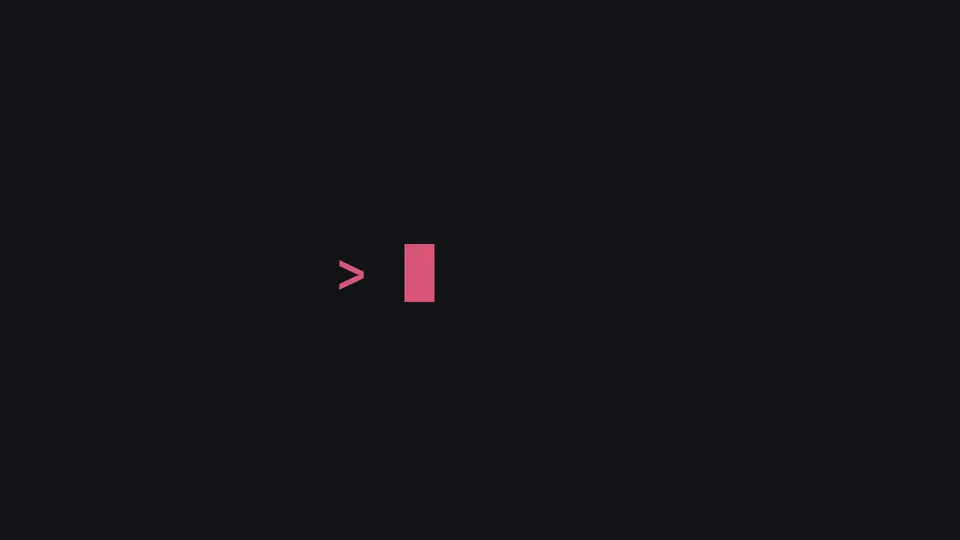
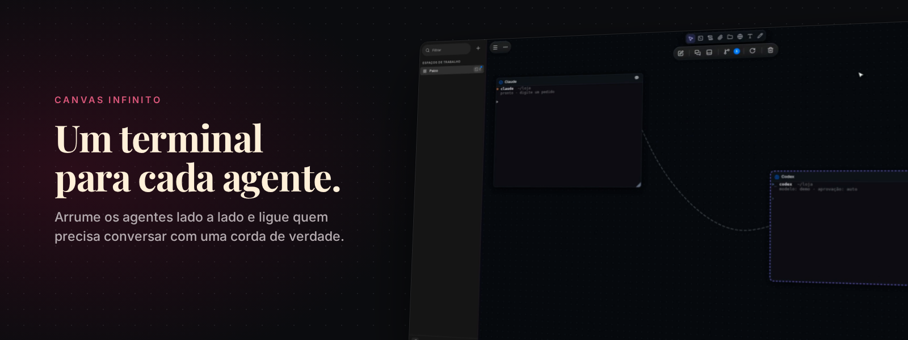
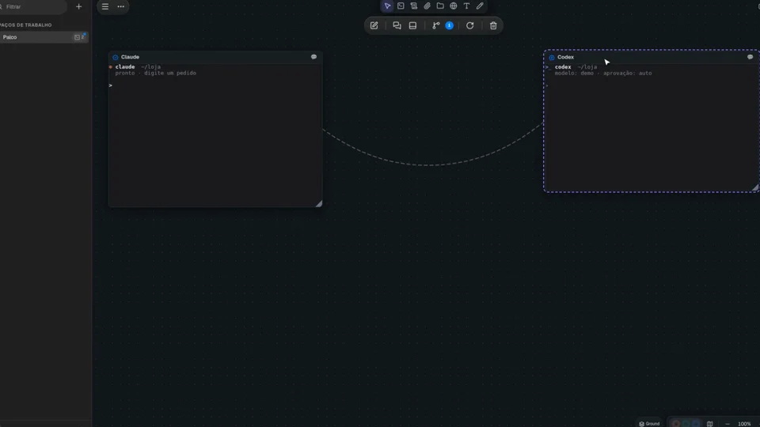
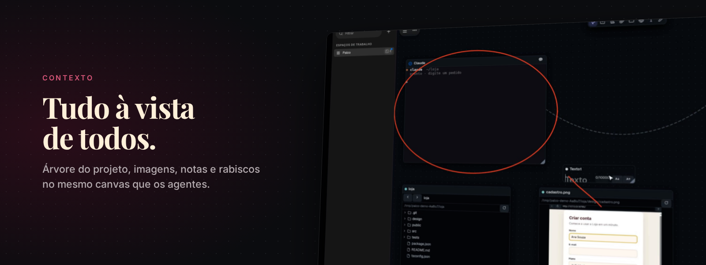
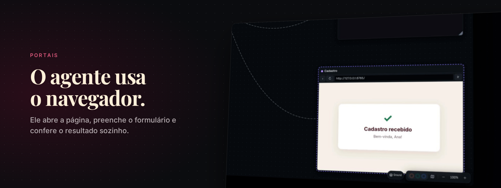
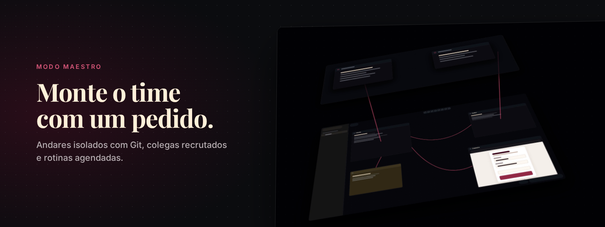

<p align="center">
  
</p>

<p align="center">
  <strong>Um palco para os seus agentes de IA.</strong><br>
  Terminais, notas, navegadores e agentes num canvas infinito, conversando entre si.
</p>

<p align="center">
  <a href="https://github.com/NatanVP/palco/actions/workflows/ci.yml"></a>
  <a href="LICENSE"></a>
  
  
  <a href="#como-contribuir"></a>
</p>

<p align="center">
  <a href="#instalar">Instalar</a> ·
  <a href="#recursos">Recursos</a> ·
  <a href="#cli-palco">CLI</a> ·
  <a href="#atalhos">Atalhos</a> ·
  <a href="#como-contribuir">Contribuir</a>
</p>

<p align="center">
  
</p>

<p align="center"><a href="docs/media/palco-apresentacao.mp4"><strong>▶ Assista à apresentação de 1 minuto</strong></a></p>

No vídeo: criamos agentes, conectamos os terminais, compartilhamos uma nota e acompanhamos uma revisão.

---

## O que é o palco

Trabalhar com vários agentes de IA costuma virar uma pilha de abas de terminal, cada uma no seu canto, sem saber quem está fazendo o quê. O **palco** coloca todos eles **lado a lado num canvas infinito**: cada agente ganha o seu terminal, você liga quem precisa conversar com uma corda, e o contexto do trabalho (notas, imagens, a árvore do projeto, um navegador) fica ali do lado, à vista de todos.

Você continua no comando. Os agentes trabalham, delegam e revisam uns aos outros pelo CLI `palco`, e você acompanha tudo numa janela só.

- 🎭 **Qualquer agente de terminal**: Claude Code, Codex, Antigravity, OpenCode, outros comandos ou o seu shell. OpenCode, outros comandos e o shell funcionam como terminais, sem a integração de colaboração.
- 🧵 **Colaboração de verdade**: com Claude Code, Codex e Antigravity, um agente pede, o outro executa ou revisa, e a resposta volta sozinha. Pedir e esperar respostas, sinais de prontidão e selo são integrados a esses três agentes.
- 🗺️ **Contexto visual**: notas, imagens, arquivos, árvores de pastas, desenhos e portais de navegador no mesmo canvas.
- 🎼 **Modo Maestro**: um agente monta o time, abre andares isolados com Git e agenda rotinas.
- 🔒 **Local e aberto**: organização do canvas salva localmente e código MIT.

---

## Recursos

### Um terminal para cada agente

Crie terminais pela barra de ferramentas ou com `Ctrl+T`, escolha o agente e a pasta de trabalho, e arrume o canvas do seu jeito. Para ligar dois agentes, selecione um terminal, clique em **Conectar** na barra de ações (ou pressione `Ctrl+L`) e clique no outro terminal. A **corda** representa essa conexão: tem física, cai com a gravidade e balança quando você arrasta os cartões.

<p align="center"></p>

### Agentes que conversam entre si

Com a corda no lugar, um agente fala com o outro pelo CLI `palco`. O Claude escreve o código e pede uma revisão ao Codex; o pedido chega no terminal dele, a resposta volta sozinha, e o selo verde indica a prontidão nos agentes integrados: Claude Code, Codex e Antigravity. Os recursos de integração, como responsabilidades e detecção de atividade, variam conforme o agente.

<p align="center"></p>

### Contexto à vista de todos

Ponha no canvas o que o time precisa ver: **a árvore do projeto**, **imagens** de referência, **notas** e **fichários**, **arquivos** e até um **rabisco** com o lápis para apontar o problema. Notas conectadas viram contexto que os agentes leem e escrevem.

<p align="center"></p>

### O agente usa o navegador

Um **portal** é um navegador dentro do canvas. O agente abre a página, clica, preenche formulários, tira capturas e confere o resultado, tudo pelo CLI. Por padrão, novos portais têm armazenamento isolado. Você pode optar por compartilhar cookies e dados entre portais do mesmo workspace ou globalmente.

<p align="center"></p>

### Modo Maestro: monte o time

Um terminal em **Modo Maestro** coordena os outros: recruta colegas, abre **andares**, publica o status de cada andar e agenda **rotinas**. Em projetos Git, andares podem usar worktrees e branches separadas para isolar o trabalho e depois integrá-lo de volta. Andares em pastas sem Git ou vinculados a uma pasta existente não garantem esse isolamento.

<p align="center"></p>

### E mais

| Recurso | O que faz |
| --- | --- |
| **Workspaces, espaços e grupos** | Um canvas por projeto, organizados na barra lateral. |
| **Partituras, predefinições e responsabilidades** | Reutilize equipes, configurações de terminais e instruções para agentes. |
| **Rotinas** | Prompts e comandos agendados (a cada X minutos, diariamente, semanalmente). |
| **Chat** | Converse com um agente numa interface de chat, sem perder o terminal. |
| **Opções do comando** | Opções interativas selecionadas do Claude Code e do Codex, com interruptores, campos de valor e explicações. |
| **Onde roda** | Local, tmux, SSH, contêiner Docker ou Docker Sandbox. |
| **Contas e uso** | Várias contas por agente e indicadores de uso na tela. |
| **Backups** | Raiz de dados configurável, snapshots e exportação. |

Um **workspace** é um projeto; um **andar** separa um contexto de trabalho dentro dele. Uma **partitura** salva uma equipe e seu layout; uma **predefinição (preset)** configura um terminal; uma **responsabilidade (role)** define instruções para um agente.

Os ambientes tmux, SSH e Docker são opcionais: precisam das ferramentas correspondentes e de ativação nas Configurações. Docker Sandbox usa `sbx`, mas o CLI do palco dentro dele ainda não é suportado. Docker remoto ou sem ponte local também pode limitar a comunicação com o app.

---

## Instalar

Para **Linux x86_64** com ambiente gráfico. No terminal, escolha **um** dos dois:

**Arch, CachyOS e derivados (pacman):**

```bash
curl -fsSL https://raw.githubusercontent.com/NatanVP/palco/main/install.sh | bash -s -- --pacman
```

**Flatpak:**

```bash
curl -fsSL https://raw.githubusercontent.com/NatanVP/palco/main/install.sh | bash -s -- --flatpak
```

Para **atualizar**, feche o palco e rode o mesmo comando de novo. O [`install.sh`](install.sh) baixa o pacote da última [release](https://github.com/NatanVP/palco/releases), confere o SHA-256 publicado junto dela e chama o `pacman` (com `sudo`) ou o `flatpak`, que perguntam antes de instalar. Se preferir, leia o script antes de rodar.

> [!WARNING]
> O Flatpak **não isola o palco**. Ele serve só para instalar e atualizar: o app roda direto no sistema (via `flatpak-spawn --host`), com todo o acesso da sua conta, para os terminais enxergarem `claude`, `codex`, `git` e o resto. A permissão `org.freedesktop.Flatpak` dá exatamente esse acesso. O app usa as bibliotecas do sistema, então precisa das mesmas dependências do pacote `.deb` (GTK 3, NSS, ALSA etc.) e de _user namespaces_ liberados para o sandbox do Chromium.

Os dois instalam o mesmo app e usam os mesmos dados (`~/.palco`): com ambos instalados você teria duas entradas no menu, mas só um palco aberto por vez. Para remover: `sudo pacman -R palco-bin` ou `flatpak --user uninstall io.github.NatanVP.palco`.

**Outras formas:** baixe o AppImage ou o `.deb` na página de [Releases](https://github.com/NatanVP/palco/releases).

**AppImage:**

```bash
chmod +x ./palco-*.AppImage
./palco-*.AppImage
```

**Debian / Ubuntu:**

```bash
sudo apt install ./palco_*.deb
```

Os agentes que você quiser usar (Claude Code, Codex etc.) são instalados e autenticados à parte. O palco não inclui assinaturas nem credenciais dos provedores.

<details>
<summary><strong>Compilar a partir do código-fonte</strong></summary>

Requisitos: Linux com ambiente gráfico, Node.js 22.12 ou mais novo, npm, Python 3, compilador C/C++ com `make` (para o módulo nativo `node-pty`) e Git.

Clone o repositório e entre na pasta do projeto. Se você usa nvm, execute `nvm use` para selecionar a versão do `.nvmrc`; sem nvm, instale uma versão compatível do Node por outro meio.

```bash
git clone https://github.com/NatanVP/palco.git palco
cd palco
nvm use  # opcional, se você usa nvm
npm ci
npm run build
npm start
```

Para desenvolver com recarregamento automático: `npm run dev`. Para gerar o AppImage e o `.deb` localmente: `npm run dist:linux` (os pacotes ficam em `dist/`). No Arch e derivados, `npm run dist:arch` gera também o pacote `palco-bin`; instale com `sudo pacman -U dist/palco-bin-*.pkg.tar.zst`.

Para gerar o Flatpak, instale o runtime (`flatpak install flathub org.freedesktop.Platform//26.08`) e rode `npm run dist:flatpak`: saem o repositório `dist/flatpak/` e o arquivo `dist/palco-<versão>.flatpak`, instalável com `flatpak --user install --or-update --bundle` seguido do arquivo.

Para instalar um lançador no menu de aplicativos apontando para o checkout:

```bash
npm run install:desktop            # instala
npm run install:desktop -- --remove  # remove
```

</details>

---

## Primeiros passos

1. **Crie um workspace** e escolha a pasta do seu projeto.
2. **Adicione terminais** pela barra de ferramentas ou com `Ctrl+T`, escolhendo o agente e a pasta.
3. **Ligue os agentes**: selecione um terminal, use **Conectar** (ou `Ctrl+L`) e clique no outro terminal.
4. **Dê contexto** com notas, imagens e a árvore do projeto, e conecte o que importa.
5. **Ative o Modo Maestro** no terminal que vai coordenar o time, e use andares em projetos Git para separar frentes de trabalho.

> [!IMPORTANT]
> O palco executa comandos reais na sua conta. Revise as permissões dos agentes antes de dar acesso aos seus projetos. No Codex, quando o comando não define um modo de sandbox, o palco usa `danger-full-access`; ajuste o comando do terminal conforme a sua necessidade.

---

## CLI `palco`

Os terminais abertos no palco já têm o CLI. Ele usa a identidade e as conexões do terminal atual.

```bash
palco list                                            # quem está ligado a mim
palco ask "Revisor" "Revise as alterações e aponte riscos."
palco note create "Critérios de aceitação" --name "Plano"
palco portal create http://localhost:3000 "App"
palco portal fill "App" "#email" "ana@exemplo.com"
```

Coordenando o time a partir de um terminal Maestro, com o workspace apontando para um repositório Git:

```bash
palco floor create "Checkout"
palco recruit "Front" --command claude --floor "Checkout"
palco routine create "Testes noturnos" --command "Execute npm test e resuma o resultado." --daily 03:00 --terminal "Front"
palco floor status "Em andamento" --progress 1/3 --floor "Checkout"
```

O andar parte da branch ou commit atual do repositório-base. `--from /caminho/do/repositorio` escolhe outra pasta de base, não uma branch. O status acima é publicado no andar Checkout, mesmo que o Maestro esteja no térreo.

Com terminal de agente, a rotina envia o conteúdo como prompt. Para executar um comando sem agente, omita `--terminal`: a rotina roda em segundo plano na pasta do workspace ou andar do chamador. Para rodar no Checkout, crie-a a partir de um terminal nesse andar.

Outras famílias: `workspace`, `space`, `band`, `role`, `preset` e `partitura`. Use `palco help` ou `palco <comando> --help` para ver as opções.

### Skills

As skills em `resources/skills/` ensinam os agentes a usar o palco: conversar, compartilhar notas, coordenar terminais, navegar em portais, administrar workspaces e rotinas. O palco tenta instalar ou atualizar as skills ao preparar terminais compatíveis; se não conseguir, mostra um aviso. Basta pedir em linguagem natural: *"pede pro Revisor olhar isso"*, *"cria uma nota com o plano"*, *"abre um andar para este trabalho"*.

---

## Atalhos

Personalize em **Configurações → Atalhos**. Os principais:

| Atalho | Ação |
| --- | --- |
| `Ctrl+T` | Novo terminal |
| `Ctrl+P` | Busca |
| `Ctrl+L` | Conectar elementos |
| `Ctrl+Shift+P` | Compositor de prompts |
| `Ctrl+Shift+L` | Partituras |
| `Ctrl+Shift+J` | Alternar chat e terminal |
| `Ctrl+S` | Barra lateral |
| `Ctrl+D` | Duplicar seleção |
| `Ctrl+,` | Configurações |
| `Ctrl+Z` / `Ctrl+Shift+Z` | Desfazer / refazer |
| `Ctrl+=` / `Ctrl+-` / `Ctrl+0` | Zoom |
| `Esc` | Cancelar e voltar à seleção |

Os atalhos do canvas dependem de onde está o foco: editores, terminais e portais podem tratar suas próprias teclas.

---

## Dados e privacidade

A organização do canvas é armazenada localmente, em `~/.palco` por padrão, com raiz configurável. As bases de skills e o armazenamento do Electron têm locais próprios. Agentes e páginas abertas podem enviar dados aos serviços que você utiliza; em ambientes remotos, comandos e arquivos também podem ficar no destino.

Faça backups pelas Configurações antes de mudanças grandes; eles podem conter mensagens e arquivos de trabalho, então guarde-os com o mesmo cuidado que os seus projetos.

Documentação: [Arquitetura](docs/referencia-arquitetura.md) · [Dados e backups](docs/data-backups.md) · [Contas e uso](docs/providers/contas-e-uso.md) · [Provedores Git](docs/providers/git-hosts.md)

---

## Perguntas frequentes

### Preciso de Node.js para usar o AppImage?

Não para executar o palco empacotado: o CLI usa o Node do próprio Electron. Node.js e npm são necessários para compilar o palco; os agentes podem ter requisitos próprios.

### Por que o CLI não funciona fora de um terminal do palco?

Os comandos que acessam o canvas usam a identidade e as conexões do terminal, fornecidas pelo app. Um terminal externo sem esse contexto não tem acesso; a ajuda continua disponível.

### O que o backup inclui?

Snapshots guardam o workspace e os chats/anexos dos seus terminais. A exportação completa reúne os dados da raiz do app, com exclusões. Não substitui o backup dos repositórios nem inclui cookies dos portais ou pastas de conta das CLIs. Veja [Dados e backups](docs/data-backups.md).

### Onde escolho o modo de sandbox do Codex?

No campo **Comando** do terminal ou do preset. Por exemplo, `codex --sandbox workspace-write` define esse modo explicitamente. Sem um modo de sandbox no comando, o palco acrescenta `danger-full-access`.

---

## Plataformas

O palco roda hoje no **Linux**. O código é aberto justamente para que a comunidade leve o palco a outros sistemas: **versões para Windows e macOS são muito bem-vindas**. Se quiser puxar essa frente, abra uma issue para alinharmos o caminho.

---

## Segurança

Para reportar vulnerabilidades, siga a [política de segurança](SECURITY.md). Não abra uma issue pública com detalhes de vulnerabilidade.

---

## Como contribuir

Contribuições de código, documentação, traduções e relatos de problemas são bem-vindas. Veja o [guia de contribuição](CONTRIBUTING.md) para preparar o ambiente, testar e enviar sua mudança por fork e pull request.

Toda mudança entra por pull request para `main`, com o CI verde. Para vulnerabilidades, siga o canal privado de [SECURITY.md](SECURITY.md).

---

## Licença

[MIT](LICENSE) © 2026 Natan. As dependências mantêm as suas próprias licenças e avisos.

<p align="center"><sub>Feito para quem rege agentes. 🎭</sub></p>
